# DisasterLink — Offline Disaster Communication & Rescue Coordination

DisasterLink connects citizens, authorities and rescue teams during disasters when normal Internet/mobile connectivity is unavailable.

## Components

- `DisasterLinkAndroid_Module4_5` — Kotlin/Jetpack Compose Android app, Room, WorkManager and BLE.
- `disasterlink-backend_Module4_5` — Node.js/Express API with SQLite.
- `disasterlink-backend_Module4_5/esp32/field-node` — BLE + LoRa field node.
- `disasterlink-backend_Module4_5/esp32/gateway` — LoRa + Wi-Fi/LAN gateway with offline NVS queue.

## Core workflow

```text
Citizen / Field Android
        ↓
BLE
        ↓
Field ESP32
        ↓ LoRa
Gateway ESP32
        ↓ local LAN / Internet when available
Backend + SQLite
        ↓
Authority
        ↓
Team UUID assignment
        ↓
Rescue member
        ↓
Accept → In Progress → Evidence → Completed
```

## What was fixed in this final implementation

- Reconstructed the corrupted backend database module.
- Fixed Android Room `clientId` schema mismatch and migration.
- Fixed Authority team registration to use backend verification.
- Enforced Team UUID semantics for task assignment.
- Prevented duplicate active tasks per emergency.
- Fixed offline task reassignment synchronization.
- Fixed offline Android/LoRa duplicate emergency risk.
- Fixed rescue task action error handling.
- Added team deletion safety.
- Added duplicate rescue membership protection.
- Added invite district validation and transactional invite consumption.
- Added duplicate feedback protection.
- Persisted field-node LoRa sequence counter.
- Removed live secrets from the distributable package.

## Start

See `FINAL_SETUP.md` for the complete setup and physical test procedure.

## Automated QA

From the backend directory:

```bash
npm install
npm run test:qa
```

The test suite is intentionally focused on the high-risk operational paths rather than only HTTP 200 happy paths.


## 📱 Application Screenshots

### Citizen Module
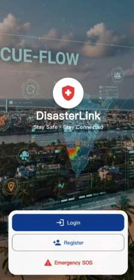
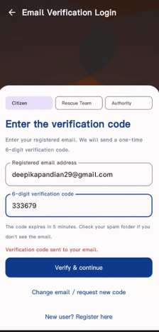
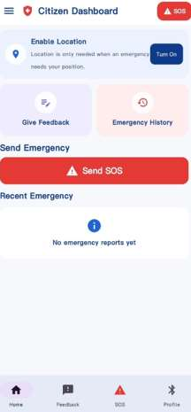
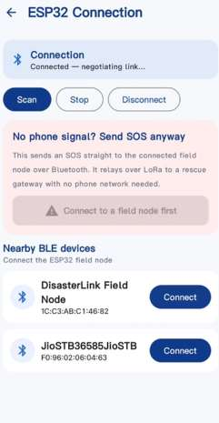
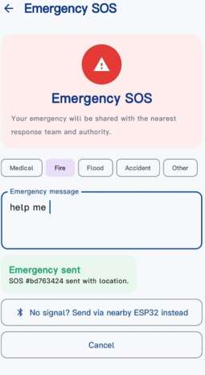

### Authority Module
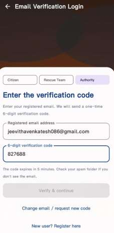
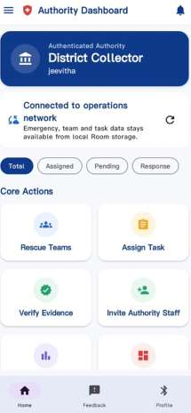
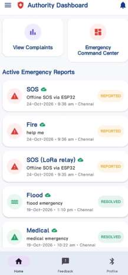
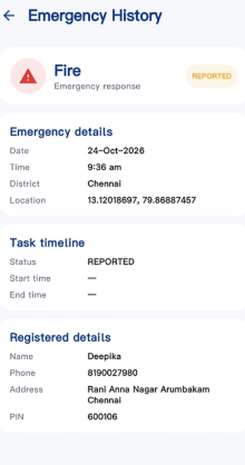
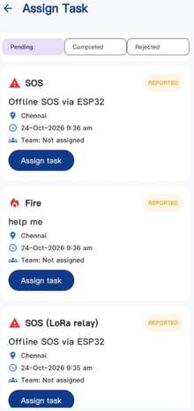
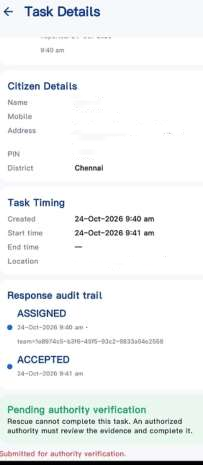
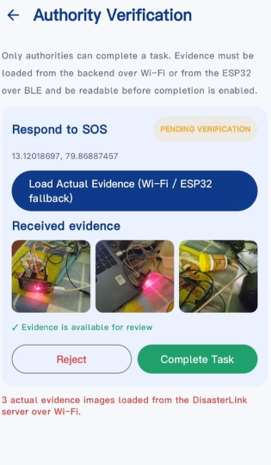

### Rescue Team Module
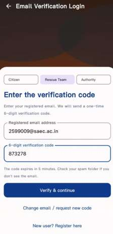
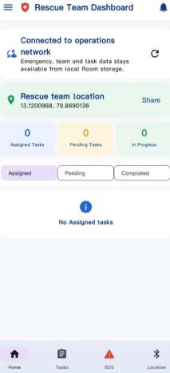
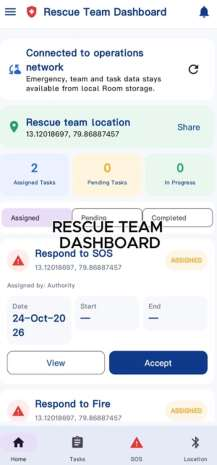
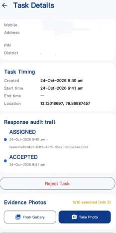
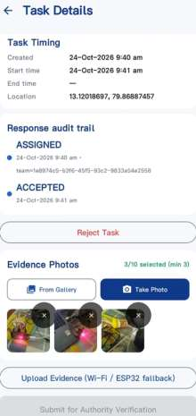

## Final Task Verification Workflow

Rescue members cannot complete tasks directly. The final workflow is:

`ASSIGNED → IN_PROGRESS → PENDING_VERIFICATION → COMPLETED`

Rescue selects at least 3 evidence images, transfers them to the field ESP32 over BLE, then submits the task for verification. An Authority phone retrieves the evidence from the ESP32 over BLE, reviews the images, and is the only role allowed to press **Complete Task**. Completion resolves the emergency.

See `FINAL_SETUP.md` for the complete setup and hardware procedure.

## Online evidence verification

When operational Wi-Fi/LAN is available, Rescue evidence is uploaded as actual compressed JPEG bytes to the backend. Authority can then open **Verify Evidence → Load Actual Evidence** and see the real stored images directly over Wi-Fi. The evidence API requires authentication.

The offline BLE path remains available as a fallback: Rescue can store the images on the field ESP32 and Authority can retrieve them from the ESP32 when backend connectivity is unavailable.

## Completed tasks cannot be reassigned

The Authority assignment screen does not offer reassignment for a `COMPLETED` task, and the backend independently rejects reassignment attempts for completed tasks with HTTP `409`. This server-side rule remains effective even if an old Android client tries to call the endpoint.
